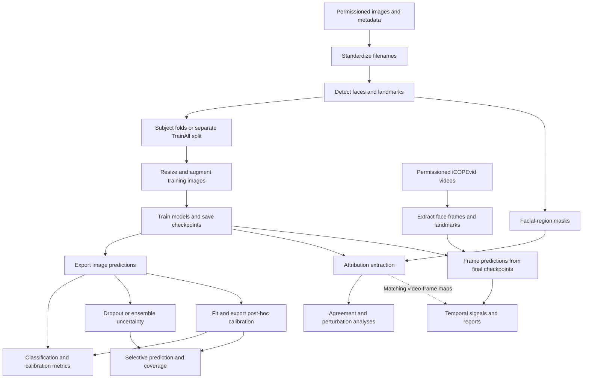

# AI Assessment of Pain in Newborns

Neonates cannot report pain verbally, making behavioral assessment an important research and clinical concern. This repository investigates facial-expression analysis with deep learning for binary **pain/no-pain classification**, together with predictive uncertainty, probability calibration, explainability, and temporal analysis. It supports academic research developed at Centro Universitário FEI in partnership with UNIFESP; the [associated publications](#results-and-publications) describe the scientific context.

**Research software:** These experiments do not constitute a clinically validated or approved medical system. Facial-expression predictions, attribution maps, uncertainty scores, and temporal signals are research measurements, not diagnoses or treatment recommendations.

This guide describes the implementation on `develop`. Reproduction requires permissioned datasets, compatible checkpoints and pretrained assets, and experiment-specific settings. Several notebooks combine current analysis with historical or exploratory blocks; their Markdown notes identify prerequisites and compatibility gaps.

## Contents

- [Key features and research contributions](#key-features-and-research-contributions)
- [Research workflow](#research-workflow)
- [Repository structure](#repository-structure)
- [Notebooks and experimental analysis](#notebooks-and-experimental-analysis)
- [Datasets](#datasets)
- [Installation and environment setup](#installation-and-environment-setup)
- [Dataset preparation](#dataset-preparation)
- [Model architectures](#model-architectures)
- [Model training and validation](#model-training-and-validation)
- [Predictive uncertainty](#predictive-uncertainty)
- [Model calibration](#model-calibration)
- [Explainable artificial intelligence](#explainable-artificial-intelligence)
- [Operational limits and temporal analysis](#operational-limits-and-temporal-analysis)
- [Results and publications](#results-and-publications)
- [Reproducibility and research limitations](#reproducibility-and-research-limitations)
- [Citation](#citation)
- [License acknowledgments and contact](#license-acknowledgments-and-contact)

## Key features and research contributions

| Capability | Implementation and scope |
|---|---|
| Facial-expression classification | [NCNN](models/NCNN.py), [VGGFace](models/VGGFace.py), and [ViT](models/ViT.py), trained through [train.py](train.py) with model-specific transforms. |
| Subject-based evaluation | [leave_some_subject_out.py](leave_some_subject_out.py) constructs ten subject-grouped folds. Its additional `TrainAll` split is image-based; see the [partitioning caveats](#partitioning-and-model-selection). |
| Training-target comparisons | [0_train.ipynb](0_train.ipynb) orchestrates ViT runs with label smoothing and NFCS-derived soft targets, including independently seeded ensemble members. |
| Predictive uncertainty | [MCDropout](uncertainty/MCDropout.py), ensemble aggregation in [1_create_data.ipynb](1_create_data.ipynb), and spread/entropy analyses in [3_uncertainty.ipynb](3_uncertainty.ipynb). |
| Probability calibration | Four transformations in [calibration/calibrators.py](calibration/calibrators.py), fitting/export in [1_create_data.ipynb](1_create_data.ipynb), and metrics/comparisons in [2_validation_metrics.ipynb](2_validation_metrics.ipynb) and [4_calibration.ipynb](4_calibration.ipynb). |
| Explanation and facial-region analysis | Repository IG/Grad-CAM in [XAI/](XAI), map aggregation and anatomical comparisons in [5_XAI.ipynb](5_XAI.ipynb), and a broader Captum registry in [RGU_XAI_PAPER.ipynb](RGU_XAI_PAPER.ipynb). |
| Attribution agreement and functional evaluation | Pixel/region agreement, initialized-model and spatial controls, and perturbation responses in [RGU_XAI_PAPER.ipynb](RGU_XAI_PAPER.ipynb); prototypes in [RGU_notebook.ipynb](RGU_notebook.ipynb). Agreement and perturbation faithfulness are separate questions. |
| Selective prediction | Decision boundaries, probability acceptance bands, spread cutoffs, and coverage comparisons in [6_limits.ipynb](6_limits.ipynb). |
| Temporal analysis | Frame extraction, stochastic/ensemble predictions, smoothed pain-sign curves and reports in [7_icopevid.ipynb](7_icopevid.ipynb) and [ttt_optimized.py](ttt_optimized.py). |

These tools investigate discrimination, reliability, and model behavior; their presence does not establish clinical outcomes or generalization to new populations.

## Research workflow



Image preprocessing has an ordered dependency chain. Subsequent analyses branch from saved checkpoints and predictions; they are not a mandatory linear sequence. Calibration fitting occurs in `1_create_data.ipynb`, rather than `4_calibration.ipynb`. The default model comparison in `4_calibration.ipynb` consumes accepted-prediction files from `6_limits.ipynb`, so it can require that analysis first. Video experiments use final checkpoints and separately prepared frames; regional video reports also require matching frame-attribution assets.

## Repository structure

The tree summarizes tracked code and metadata. Datasets, checkpoints, analysis caches and generated figures are local resources rather than a complete reproducibility bundle.

```text
.
├── README.md
├── AGENTS.md                      # Contribution and privacy rules
├── requirements.txt               # Pinned pip snapshot
├── environment.yml                # Windows Conda/Python export
├── iCOPE+UNIFESP_data.csv          # Image mapping, labels, subjects and face metadata
├── UNIFESP_percep_heatmaps.csv     # Perception-map/image associations
├── create_dataset.py              # Copy and rename permissioned inputs
├── face_detection.py              # Face crops, landmarks and metadata update
├── leave_some_subject_out.py       # Ten subject folds plus image-based TrainAll
├── data_augmentation.py            # Resize, augment and transform five keypoints
├── crop_facial_regions.py          # Landmark-defined regional crops
├── train.py                        # YAML-configured single-run training
├── validate.py                     # Validation functions; no standalone CLI
├── ttt_optimized.py                # Temporal estimators and reports
├── models/
│   ├── NCNN.py
│   ├── VGGFace.py
│   ├── ViT.py
│   └── configs/                    # Five supplied experiment YAMLs
├── dataloaders/                    # Image/video loaders and transform presets
├── uncertainty/                    # MC-dropout wrapper
├── calibration/                    # Calibrators and metrics
├── XAI/                            # IG, Grad-CAM, RISE, feature maps, regions, processing
├── corruption/                     # Image corruption and masking utilities
├── facial_features/                # Eye/mouth aspect-ratio utilities
├── utils/                          # Config, geometry, CSV and plot helpers/styles
├── tests/test_pain_sign_layout.py   # Synthetic temporal display checks
├── 0_train.ipynb ... 7_icopevid.ipynb
├── RGU_XAI_PAPER.ipynb
├── RGU_notebook.ipynb
├── graficos axuliares.ipynb
├── lancet.ipynb
└── teste_cassia.ipynb
```

Use imports from the repository root:

```python
from models import NCNN, VGGFace, ViT
from dataloaders import BaseDataset, iCOPEVidDataset
from XAI import IntegratedGradients, GradCAM
from uncertainty.MCDropout import MCDropout
from validate import validation_metrics, calibration_metrics
```

`VGGNB` occurs in historical notebooks, but the current model export is `VGGFace`. The package is named `dataloaders`, not `dataloader`.

## Notebooks and experimental analysis

All 13 tracked notebooks are listed below. Outputs describe what the code is intended to produce with compatible resources/interfaces; saved outputs are historical records, not proof that a notebook currently runs from top to bottom.

| Notebook | Research objective | Main methods | Expected outputs |
|---|---|---|---|
| [0_train.ipynb](0_train.ipynb) | Schedule ViT target/ensemble experiments on folds and `TrainAll`. | Sequential `train.py` jobs; member seeds; smoothing and sigmoid/linear/step NFCS targets. | Runtime YAML, checkpoints, logs and evaluation plots; no ensemble aggregation. |
| [1_create_data.ipynb](1_create_data.ipynb) | Export checkpoint predictions and calibration variants. | Deterministic/MC-dropout inference; member-probability averaging; four calibrators fitted per fold. | Train/evaluation prediction pickles, ensemble pickles and calibrated directories. |
| [2_validation_metrics.ipynb](2_validation_metrics.ipynb) | Describe fold-level discrimination/calibration. | Classification metrics; ECE/MCE/NLL/Brier; averaged reliability curves and histograms. | Fold arrays, tables and `calib_curve.pdf`; unavailable variants are skipped. |
| [3_uncertainty.ipynb](3_uncertainty.ipynb) | Relate uncertainty to errors and dataset composition. | Population spread; binary entropy; distribution tests; dropout/member-count sweeps; affine alignment. | Uncertainty CSVs, correlations, figures and local image panels; optional historical embedding block. |
| [4_calibration.ipynb](4_calibration.ipynb) | Compare model, calibration and uncertainty strategies. | Common-fold Friedman; paired Wilcoxon; K-S probability tests. | Statistics, p-value tables and paired-fold counts; no calibrator fitting. |
| [5_XAI.ipynb](5_XAI.ipynb) | Extract gradient maps and compare facial regions. | IG/Grad-CAM; dropout/ensemble map weighting; region means; top-region agreement; affine averages and historical IoU. | Maps, overlays, region tables, heatmaps and montages; historical helper/format dependencies. |
| [6_limits.ipynb](6_limits.ipynb) | Evaluate selective prediction. | Youden boundaries; probability bands; spread rejection; joint policies and random-rejection comparisons. | CSV audit, four accepted-prediction pickles, coverage/metric tables, sweeps and rejection panels. |
| [7_icopevid.ipynb](7_icopevid.ipynb) | Investigate temporal facial-pain signals. | Face/frame/audio preparation; stochastic inference; interpolation/smoothing; region correlations; clustering and agreement. | Frame/mesh/audio assets, video predictions, PDF/MP4 reports and CSV/LaTeX metric tables. |
| [RGU_XAI_PAPER.ipynb](RGU_XAI_PAPER.ipynb) | Compare explanations and functional perturbation responses. | Ten Captum explainers; initialized/edge/noise controls; pixel/region agreement; MoRF/LeRF/random perturbations; AOPC/AUC; statistics; PCA/t-SNE. | NPZ maps, prediction CSVs, caches, response curves, rankings, figures and tables. Stateful workbench with forward dependencies and prototype gaps. |
| [RGU_notebook.ipynb](RGU_notebook.ipynb) | Explore explanation-quality scores, agreement and concepts. | Imported sensitivity/infidelity; agreement; embeddings; TCAV; regional LIME; RISE; FLOPs and Quantus prototypes. | Rankings, maps, embeddings and concept/library diagnostics. Exploratory; incompatible interfaces/selections in several blocks. |
| [graficos axuliares.ipynb](graficos%20axuliares.ipynb) | Prepare auxiliary research illustrations. | Empirical ECE binning; synthetic calibration/soft-target/spread examples; local face/region/corruption displays. | Illustrative plots and regional displays. Synthetic curves are not measured results. |
| [lancet.ipynb](lancet.ipynb) | Explore historical thresholds and video trajectories. | Same-record ROC fitting/evaluation; moving averages/low-pass filtering; entropy/crossings; K-means and model comparisons. | Historical metrics, descriptors, clusters and figures; older schemas, paths and fixed dimensions. |
| [teste_cassia.ipynb](teste_cassia.ipynb) | Compare historical maps and a separate face-recognition experiment. | IoU/MSE/Pearson/Wilcoxon; affine differences; centroids; external logs and checkpoint attribution evolution. | CSVs, figures and Grad-CAM GIF. Its 10,572-output identity experiment is not neonatal pain classification. |

Read introductory prerequisites and the notes beside the relevant cells. Check paths, architecture, split, checkpoint, map format and helper redefinitions for each selected block. Avoid launching every training cell or treating a preserved execution count as a reproduction record.

## Datasets

**Obtain access from the respective dataset owners.** iCOPE, UNIFESP, perception heatmaps and iCOPEvid are permissioned resources. This repository grants neither access nor redistribution rights. Keep patient images, video/audio, panels, paths and identifying metadata in the approved local environment; do not upload them to public issues, pull requests or logs.

| Resource | Modality and role | Labels and metadata |
|---|---|---|
| iCOPE | Still facial-expression images, combined with UNIFESP. | Dataset/class, filenames and subjects in [iCOPE+UNIFESP_data.csv](iCOPE%2BUNIFESP_data.csv). Only literal `pain` and `nopain` classes enter folds; other conditions are excluded. |
| UNIFESP | Still neonatal images for classification and human/machine comparisons. | Same CSV, with NFCS values for soft targets. Soft-target training selects UNIFESP files only. |
| UNIFESP perception heatmaps | Human-perception maps associated with images. | [UNIFESP_percep_heatmaps.csv](UNIFESP_percep_heatmaps.csv): `heatmap_file_name`, `new_percep_file_name`, `new_file_name` and `persona`. Copying does not align every map to a crop. |
| Facial landmarks | InsightFace five keypoints and 106-point meshes for geometry/XAI. | Five points in the image CSV and fold `Keypoints/*.pkl`; separate meshes in `DatasetFaces/Landmarks/*.pkl`. These are different representations. |
| iCOPEvid | MP4 video and optional audio for frame/temporal analysis. | Extraction selects names containing `Pain` or `Rest`. Video labels are name-derived, not independent frame annotations; the loader identifies `blank` frames. |

The tracked image CSV has **645 mapping rows**: 288 iCOPE and 357 UNIFESP. Its 521 binary-label rows comprise iCOPE 76 pain/88 no-pain and UNIFESP 162 pain/195 no-pain. These are metadata counts before detection filtering, not guaranteed available images, final fold sizes or official dataset-wide statistics. The perception CSV has 100 association rows, not necessarily 100 distinct neonatal images.

### Local inputs and metadata

Source paths in the tracked CSVs expect:

```text
Datasets/                          # Local; ignored by Git
└── Originais/
    ├── iCOPE/pilot/                # Original filenames
    ├── UNIFESP/                    # Original filenames
    └── PERCEP_HEATMAPS/            # Original perception maps
```

`create_dataset.py` copies directly from CSV path fields. Files under a similarly named directory are insufficient if those fields do not resolve. Preserve original filenames and the standardized pattern `{ID}_{DATASET}_{SUBJECT}_{CLASSIFICATION}`. The CSVs use Windows backslashes; other operating systems require path adaptation. Video roots are assigned separately in `7_icopevid.ipynb`; the still-image CSV is not a video annotation manifest.

## Installation and environment setup

Run from the repository root. [environment.yml](environment.yml) records **Python 3.10.16**, Windows-specific Conda builds and an absolute author prefix. Both dependency files pin PyTorch `2.6.0+cu126`, torchvision `0.21.0+cu126` and torchaudio `2.6.0+cu126`. These are environment records, not a tested compatibility matrix or portable lockfile.

### Clone and select the research branch

```bash
git clone --branch develop https://github.com/darkrubiks/AI-Assessment-of-Pain-in-Newborns.git
cd AI-Assessment-of-Pain-in-Newborns
```

### Windows environment matching the recorded Python version

These commands use Bash syntax, for example an initialized Git Bash/Conda shell on Windows. The extra index supplies the pinned CUDA 12.6 wheels; see the [official PyTorch 2.6 installation instructions](https://docs.pytorch.org/get-started/previous-versions/).

```bash
conda create --name neonatal-pain python=3.10.16 pip
conda activate neonatal-pain
python -m pip install --extra-index-url https://download.pytorch.org/whl/cu126 -r requirements.txt
```

Alternatively, use the recorded Conda export with a local name overriding the author's environment location:

```bash
PIP_EXTRA_INDEX_URL=https://download.pytorch.org/whl/cu126 conda env create --file environment.yml --name neonatal-pain
conda activate neonatal-pain
```

`requirements.txt` includes Windows packages such as `pywin32`; the Conda export also has Windows runtime/build pins. Linux/macOS require a separately adapted environment and path configuration. InsightFace may need build tools and downloaded model assets; its [upstream Python-package documentation](https://github.com/deepinsight/insightface/tree/master/python-package) describes those resources and usage restrictions. Dependency resolution must be checked locally; a clean install has not been certified by this documentation review.

### Notebook dependencies and pretrained assets

The snapshots differ: `environment.yml` includes Captum `0.8.0` and statsmodels `0.14.4`, while `requirements.txt` omits both. Relevant XAI/statistics blocks using the pip route additionally require:

```bash
python -m pip install captum==0.8.0 statsmodels==0.14.4
```

Use an existing Jupyter/IDE frontend, or install one locally:

```bash
python -m pip install notebook
python -m notebook
```

MoviePy (`moviepy.editor` in the audio block), Quantus and calflops occur in selected notebooks but are absent from both snapshots. Compatible versions are not recorded; obtain an appropriate environment for those blocks. FFmpeg/video codecs may be needed for audio or MP4 reports.

VGGFace requires the untracked serialized model `models/weights/VGG_face_original_model.pt`. Obtain a compatible file from the authors; no verified download command is supplied. ViT initialization requests torchvision ImageNet weights and can need network/cache access. Task-trained checkpoints, prediction artifacts and analysis caches also remain local.

### Installation checks without patient data

```bash
python -m pip check
python -c "import torch, torchvision, pandas, numpy, cv2, yaml; print(torch.__version__, torchvision.__version__); print('CUDA available:', torch.cuda.is_available())"
python train.py --help
python -m compileall -q .
python -m unittest discover -s tests -p test_pain_sign_layout.py
```

`train.py --help` reads the parser without training. Existing tests use synthetic temporal-display inputs and a missing-dataset path; they do not validate scientific results. These checks still require imported dependencies. Preprocessing scripts execute at module level and do not offer a safe `--help` or `--dry-run` interface.

All supplied YAMLs select `device: cuda`. A compatible CPU runtime can be selected in a local experiment config; performance depends on workload. `1_create_data.ipynb` selects CUDA if available, but several XAI/video blocks explicitly select CUDA. Offline metrics need no model acceleration. Detection requests CUDA and CPU ONNX providers, whose availability depends on the runtime. No GPU-memory or runtime guarantee is provided.

## Dataset preparation

Verify permissions, source-file availability, detector assets and output backups first. **Scripts can delete generated directories, overwrite resized images and update the tracked image CSV.** They are not incremental preparation commands. Failed detections can be skipped; no complete pipeline-wide missing-data preflight exists.

Check source paths without copying images or executing research scripts:

```bash
python - <<'PY'
import csv
from pathlib import Path

for metadata, column in [
    ('iCOPE+UNIFESP_data.csv', 'file_name'),
    ('UNIFESP_percep_heatmaps.csv', 'heatmap_file_name'),
]:
    if not Path(metadata).is_file():
        raise SystemExit(f'Metadata not found: {metadata}')
    with open(metadata, encoding='utf-8-sig', newline='') as handle:
        missing = sum(not Path(row[column]).is_file() for row in csv.DictReader(handle))
    if missing:
        raise SystemExit(f'Dataset not found or incomplete: {missing} source files missing for {metadata}')
print('All metadata source paths exist.')
PY
```

This checks existence, not consent, label validity or readability; it avoids printing patient filenames.

| Stage | Command | Inputs and created/updated resources |
|---|---|---|
| 1. Standardize | `python create_dataset.py` | Reads both CSVs; copies source images/maps to `Datasets/NewDataset/Images` and `Heatmaps`. Removes existing `NewDataset` first. |
| 2. Detect | `python face_detection.py` | Reads standardized images/metadata; uses the first detected face. Recreates `Datasets/DatasetFaces/Images` and `Landmarks`; writes crops/106-point meshes and overwrites CSV face/keypoint columns. |
| 3. Partition | `python leave_some_subject_out.py` | Reads face images/updated metadata; excludes failed detections and nonbinary classes. Recreates `Datasets/Folds/0` through `9`, each with `Train`/`Test`, and separate `TrainAll/Train`/`Test`. |
| 4. Resize/augment | `python data_augmentation.py` | Processes every fold, including `TrainAll`. Overwrites originals at 512 × 512; test images receive resizing only. Each training JPEG produces 20 additional affine/brightness/contrast/flip variants and five-point pickles in each split's `Keypoints` directory. |

Detection saves native-size crops but scales the separate 106-point meshes to a 512 × 512 reference. Augmentation transforms **five keypoints**, not those meshes. Rerunning augmentation can process already augmented JPEGs; start from the intended unaugmented folds. Audit exclusions and membership before training.

Optional regional crops use [crop_facial_regions.py](crop_facial_regions.py):

```bash
python crop_facial_regions.py --output outputs/cropped_regions --square
```

Its parser accepts `--images`/`--landmarks`, but `main()` uses fixed `Datasets/DatasetFaces/Images` and `Landmarks` roots, so those flags do not change inputs. Masks are expanded, bounding crops optionally squared and outputs resized to 128 × 128. Use matching geometry; crop generation is not validated anatomical segmentation.

## Model architectures

All three classifiers emit one raw logit per image. `predict()` applies sigmoid for the positive-class probability, normally thresholded at 0.5. [dataloaders/presets.py](dataloaders/presets.py) defines inputs.

| Exported model | Architecture and training scope | Input preset | Implementation/configuration |
|---|---|---|---|
| `NCNN` | Three-branch neonatal CNN with merged features and an 8-unit hidden classifier; initialized without pretrained task weights by `train.py`. | RGB, 120 × 120, float tensor. | [NCNN.py](models/NCNN.py); [baseline](models/configs/config_NCNN.yaml), [tuned](models/configs/config_Tuned_NCNN.yaml), [pretrained-named YAML](models/configs/config_NCNN_pretrained.yaml). |
| `VGGFace` | Local VGG-Face model; existing parameters frozen, head replaced by two 512-unit hidden layers with dropout and a single output. | 224 × 224, BGR channel order and preset mean subtraction. | [VGGFace.py](models/VGGFace.py); [config_VGGFace.yaml](models/configs/config_VGGFace.yaml). Requires the serialized backbone. |
| `ViT` | torchvision ViT-B/32 with `IMAGENET1K_V1`; existing parameters frozen and a trainable single-logit head installed. | RGB, 224 × 224, ImageNet mean/std normalization. | [ViT.py](models/ViT.py); [config_ViT.yaml](models/configs/config_ViT.yaml). |

`NCNN-Tuned` is a config variant, not another class. `config_NCNN_pretrained.yaml` does not itself load weights: `train.py` instantiates the class without checkpoint-loading arguments. Current exports do not include ResNet, SENet or Inception, although earlier publications study them. The 2025 video paper describes ViT-B/16; this checkout implements ViT-B/32. Match exact revisions/checkpoints before attributing paper results to current models.

## Model training and validation

### Single-run training

After preparing data and the environment, a supplied fold-zero example is:

```bash
python train.py --config models/configs/config_NCNN.yaml
```

`--config` is the only project-specific training argument; supply an existing YAML. A run processes one train/evaluation pair, not automatic ten-fold cross-validation.

| YAML fields | Effect |
|---|---|
| `model`, `path_train`, `path_test` | Exported class and split directories. |
| `device`, `batch_size`, `cache`, `num_workers`, `pin_memory` | Compute and loader settings; caching retains transformed inputs/labels in RAM. |
| `epochs`, `patience` | Epoch limit and early stopping on evaluation loss. |
| `optimizer`, `optimizer_hyp` | PyTorch optimizer name and constructor arguments. |
| `scheduler`, `scheduler_hyp` | Optional scheduler; the loop calls `step()` once per epoch without a monitored metric. Not every scheduler interface fits. |
| `soft_label`, `label_smoothing` | Hard targets use the string `None`; alternatives are `SIGMOID`, `LINEAR`, `STEP`. Smoothing is `(1-epsilon)y + epsilon/2`. Do not combine soft targets with nonzero smoothing. |
| `seed`, `save_dir` | Python/NumPy/PyTorch seeds and output root; defaults apply when absent. |

Supplied YAMLs are the exact hyperparameter source. Tuned NCNN uses RMSprop and `CosineAnnealingLR`; other configs have their own settings and several select `TrainAll`. `soft_label: None` is a string here, not YAML `null`. The loader does not comprehensively validate missing/invalid fields. Supplied paths use Windows separators.

[BaseDataset](dataloaders/BaseDataset.py) derives hard labels from filename suffixes: `nopain` is 0 and pain is 1 for the intended binary dataset. NFCS soft targets select UNIFESP only and apply class/NFCS adjustments before mapping. Thus these strategies change the sample population and target interpretation, rather than post-hoc recalibrating one fitted model.

### Partitioning and model selection

The fold script intends ten subject-grouped splits stratified by dataset using `new_subject`. However, subjects come from an unordered `set`, while stratification labels come from metadata row order, without explicit alignment. Subject membership is grouped, but exact folds and dataset stratification require audit; a training seed does not establish deterministic partition reproduction.

`TrainAll` is a separate 90/10 image-level split, stratified by class with random state 42, without guaranteed patient independence. `train.py` also evaluates `path_test` every epoch and selects the minimum-loss checkpoint/early stopping on it. That set serves model selection and is not an untouched final test set. Independent subject-level final evaluation needs a separate protocol.

[0_train.ipynb](0_train.ipynb) orchestrates ViT jobs over existing folds and seeded members; it does not construct splits. Its six cross-validation target variants imply 60 single-model jobs and 600 ensemble-member jobs, plus final `TrainAll` jobs. Review the workload. Shared runtime YAML and inherited output settings require careful artifact management during concurrent use.

### Checkpoints, metrics and validation artifacts

Training writes under `save_dir` (or `experiments`):

```text
<YYYYMMDD_HHMM>_<model>/
├── Logs/train_log.csv
├── Logs/test_log.csv
├── Model/best_model.pt             # state_dict selected by evaluation loss
├── Model/config.yaml               # Copied run configuration
└── Results/                        # Reliability, confusion, ROC, PR, threshold plots
```

Minute-resolution timestamps can collide. Seeding helps repeatability but does not enforce deterministic backend algorithms, augmentation or split reproduction.

[validate.py](validate.py) is a function module, **not** a `python validate.py --config ...` command. It offers accuracy, precision, sensitivity/recall, specificity, F1 and ROC AUC (NaN for unsupported single-class evaluations), plus calibration metrics and plots. For aligned saved arrays:

```python
from validate import validation_metrics, calibration_metrics

classification = validation_metrics(preds, probs, labels)
calibration = calibration_metrics(probs, labels, n_bins=10, mode='quantile')
```

`probs` must be positive-class probabilities. Checkpoint inference/export uses `1_create_data.ipynb`: `results.pkl`/`train_results.pkl`, stochastic files such as `results_MCDP_50_0.3.pkl`, or `ensemble_10_results.pkl`. Flat dictionaries contain `fold`, `img_names`, `labels`, `probs`, `preds`; deterministic exports add `logits`, while dropout/ensemble exports add `probs_uq`. Audit completeness: failed runs can be skipped and partial results saved. Historical notebooks can expect older schemas.

## Predictive uncertainty

Extreme probabilities express class confidence, not reliability on a new patient or acquisition setting. The repository studies prediction disagreement and ambiguity of the mean.

- **MC dropout:** [MCDropout.py](uncertainty/MCDropout.py) activates existing dropout modules, replaces their rates and returns a sample-by-pass probability matrix. It neither inserts modules nor restores their prior state. The exporter commonly uses 50 passes; rate/pass count are experiment settings.
- **Deep ensembles:** `0_train.ipynb` supplies member seeds; `1_create_data.ipynb` averages deterministic probabilities and checks matching image-path sequences. Labels/folds come from the first member and need independent verification. Size sweeps in `3_uncertainty.ipynb` require corresponding artifacts.
- **Spread and entropy:** `3_uncertainty.ipynb` computes population standard deviation over pass/member probabilities and binary entropy of their mean.

For $T$ probabilities $p_{it}$:

$$
\bar p_i=\frac{1}{T}\sum_t p_{it},\qquad
s_i=\sqrt{\frac{1}{T}\sum_t(p_{it}-\bar p_i)^2},\qquad
H_i=-\bar p_i\log\bar p_i-(1-\bar p_i)\log(1-\bar p_i).
$$

Entropy uses clipped probabilities/natural logarithms (nats). Squared spread is population predictive variance; the main exported column is `stds`. Epistemic uncertainty concerns learned-model uncertainty; aleatoric uncertainty concerns observational ambiguity/noise. Dropout/member variation can probe model sensitivity, but these estimators **do not isolate both components** or implement mutual-information decomposition. Low spread can accompany a confidently wrong prediction.

## Model calibration

Calibration concerns whether samples assigned positive probability $p$ exhibit a positive-label fraction near $p$. Discrimination measures class separation/decisions; calibration measures probability agreement with outcomes. Better accuracy/AUC does not imply better calibration.

[calibration/metrics.py](calibration/metrics.py) and `validate.py` implement:

| Metric/plot | Meaning and implementation detail |
|---|---|
| ECE | Occupied-bin weighted absolute gap between mean positive probability and positive-label fraction; equal-width (`uniform`) or percentile (`quantile`) bins. |
| MCE | Largest occupied-bin probability/frequency gap. |
| NLL | Mean binary log loss, with dtype-epsilon clipping. |
| Brier score | Mean squared positive-probability error. |
| Reliability diagram | Mean positive probability versus observed positive fraction; histograms in [utils/plots.py](utils/plots.py). |

For occupied-bin sizes $n_b$ and total $N$:

$$
\mathrm{ECE}=\sum_b\frac{n_b}{N}|\bar p_b-\bar y_b|,\qquad
\mathrm{MCE}=\max_b|\bar p_b-\bar y_b|,\qquad
\mathrm{Brier}=\frac{1}{N}\sum_i(p_i-y_i)^2.
$$

These metrics bin **positive-class probabilities**, not predicted-class confidence versus correctness. Binning affects values. `2_validation_metrics.ipynb` uses ten quantile bins for metrics and uniform bins for curves by default; averaging curve arrays after removing empty bins can align different occupied bins across folds.

[calibrators.py](calibration/calibrators.py) implements Platt scaling, temperature scaling, isotonic regression and histogram binning. Platt transforms probabilities directly; temperature scaling reconstructs logits and does not constrain fitted temperature positivity; histogram binning compresses occupied-bin frequencies while retaining original edges, needing repeated/empty-bin checks.

`1_create_data.ipynb` fits transformations **on exported training predictions per fold** and updates evaluation `probs`/`preds`. Existing stochastic `probs_uq` and logits remain uncalibrated, so spread/entropy from those arrays need not describe transformed probabilities. Fold matching is not an independent calibration partition. `4_calibration.ipynb` compares stored variants; positional pairing, repeated subjects and multiple comparisons remain interpretation concerns.

## Explainable artificial intelligence

Attribution maps support inspection of model sensitivity and input dependence. They do not identify causal pain mechanisms or prove clinical significance. Baseline, output/layer target, preprocessing, normalization and perturbation design are part of the explanation experiment.

| Methods | Location and status |
|---|---|
| Integrated Gradients, Grad-CAM | Batched implementations in [IntegratedGradients.py](XAI/IntegratedGradients.py) and [GradCAM.py](XAI/GradCAM.py), used by `5_XAI.ipynb`. |
| Saliency, Integrated Gradients, DeepLIFT, DeepLIFT SHAP, Gradient SHAP, layer Grad-CAM, Guided Grad-CAM, Deconvolution, Occlusion, LIME | Captum registry in `RGU_XAI_PAPER.ipynb`, with method-specific references/windows/feature groups. These are notebook integrations, not all separate repository classes. |
| RISE | Random-mask module [RISE.py](XAI/RISE.py), explored in `RGU_notebook.ipynb`. |
| Feature maps and attention rollout | [FeatureMaps.py](XAI/FeatureMaps.py) and [attention_rollout.py](XAI/attention_rollout.py). Rollout assumes hooked modules return attention weights; availability is not established for every torchvision configuration. |
| TCAV and Quantus metrics | Exploratory blocks. Imported sensitivity/infidelity CSVs are distinct from later prototypes; several prototypes need interface fixes before valid execution. |

Custom IG defaults to **one integration step**, despite its docstring describing 50. It differentiates the single positive logit, uses a zero baseline in transformed coordinates, sums channels, clamps negative attribution and normalizes by the map maximum. Exported maps do not preserve signed attribution or completeness. Captum IG uses a separate implementation/settings path. Repository Grad-CAM uses target-layer gradients, ReLU and normalized resizing; ViT reshaping assumes a 7 × 7 patch grid for B/32.

`5_XAI.ipynb` exports quantized NPZ maps and weighted means suppressing normalized pixelwise dropout/member spread. Later sections retain pickle formats and import `attribution_mask_processing`, absent from the current package. The stochastic overlay loop exchanges IG/GC display inputs; its PNG suffixes require provenance checks even where raw-map assignments are correct.

### Facial regions, agreement and faithfulness

[XAI/metrics.py](XAI/metrics.py) constructs 512 × 512 masks from 106 landmarks for eyes, eyebrows, nose, mouth, cheeks, nasolabial regions, between-eye area, forehead and outside-face support. Notebooks can merge bilateral masks. `calculate_xai_score` returns mean processed attribution in each dilated mask; scores do not sum to one and masks can overlap.

Agreement measures include top-pixel overlap, IoU, Spearman/SSIM and top-region overlap/rank agreement. Human-perception maps and machine attributions are different measurements; concordance does not establish faithful explanation of model computations.

`RGU_XAI_PAPER.ipynb` separately perturbs inputs in most-relevant-first (MoRF), least-relevant-first (LeRF), or random order, using black, white, mean, random or imputation replacements. It retains positive-class responses, absolute probability-change curves and fold-level classification responses. Signed AOPC averages original-minus-perturbed probability; trapezoidal AUC of absolute change is a different estimator with different units. A drop in positive-class probability has different implications for pain and no-pain images.

Initialized-model controls skip task-weight loading but can retain pretrained backbones, so they are not complete parameter-randomization sanity checks. Consider spatial edge/noise controls, cache pairing, image alignment and perturbation-induced distribution shift. Composite weights estimated and evaluated on the same images are exploratory. Quantus PixelFlipping/IROF/ROAD and regional perturbation prototypes are not fully working end-to-end benchmarks as written.

## Operational limits and temporal analysis

### Selective prediction

[6_limits.ipynb](6_limits.ipynb) separates these policies:

| Policy | Implemented rule |
|---|---|
| `theta_1` | Fold-specific decision boundary maximizing fitting-record ROC `TPR - FPR` (Youden criterion), unless overridden. Changes decisions without directly rejecting rows. |
| `theta_2` | Accepts probability extremes, default `p <= 0.20` or `p >= 0.80`; interior predictions become NaN in the audit. This is not a confidence interval. |
| `theta_3` | Fits a spread cutoff with fitting-record errors as ROC positive labels; accepts `stds <= theta_3`. |
| `theta_1_2_3` | Applies `theta_1` decisions where both probability and spread rules accept. |

Fitting records normally contain training predictions. Outputs include an all-row audit CSV and four accepted-row pickles. Completely rejected folds disappear from accepted files, making coverage and effective sample/fold counts essential alongside retained metrics. Sweeps are compared with seeded random removal; some summaries/tests mean-impute undefined fold metrics. `theta_4` is an unimplemented XAI placeholder. These are research operating rules, not medical recommendations.

### Temporal pain-sign analysis

[7_icopevid.ipynb](7_icopevid.ipynb) rotates frames clockwise, crops the first detected face to 512 × 512 and saves meshes. Failed detections produce blank-marked frames with NaN predictions. Audio extraction stores 48 kHz arrays; no audio pain classifier is implemented.

[ttt_optimized.py](ttt_optimized.py) computes per-frame mean probabilities/population spread from two-dimensional pass/member blocks, interpolates missing values, averages blocks and applies a width-30 boxcar smoother by default. The workflow uses a **20-second time axis by default**, rather than deriving it from source FPS. Array orientation uses a shape heuristic; all-missing curves become zeros, and zero padding affects smoothing endpoints. Check these conventions before interpreting missing detections or transition times.

Stored model-specific decision/spread thresholds in the module are separate from freshly fitted `6_limits.ipynb` thresholds. Video decisions use the mean smoothed probability; joint limits can retain probability-extreme, low-spread samples only. Outputs include PDF/MP4 reports, optional average-face templates, region trajectories, derivative correlations, durations, transitions, coverage and classification/calibration tables.

`Stable`, `irregular` and `unstable` categories use three-cluster K-means on **unscaled** probability-histogram entropy and boundary crossings. `Indeterminate` uses sustained proximity to the boundary, distinct from spread rejection. Histogram entropy in bits differs from binary predictive entropy in nats. Regional time correlations indicate association, not causal contributions. These categories/signals are experimental summaries, not a validated monitoring system.

## Results and publications

The papers below describe related experiments. Reproduce each with its dataset selection, validation protocol, architecture revision and checkpoints. The previous README's accuracy/precision/recall/F1 table lacked a traceable run, protocol and source for each value and is not reproduced here. Notebook outputs have not been rerun or independently validated for this guide.

1. **Disclosing neonatal pain in real-time: AI-derived pain sign from continuous assessment of facial expressions.** Leonardo Antunes Ferreira, Lucas Pereira Carlini, Gabriel de Almeida Sá Coutrin, Tatiany Marcondes Heiderich, Rita de Cássia Xavier Balda, Marina Carvalho de Moraes Barros, Ruth Guinsburg and Carlos Eduardo Thomaz. *Computers in Biology and Medicine*, **189**, 109908, **2025**. DOI: [10.1016/j.compbiomed.2025.109908](https://doi.org/10.1016/j.compbiomed.2025.109908). [Bibliographic record](https://pubmed.ncbi.nlm.nih.gov/40024188/).

2. **Human vs machine towards neonatal pain assessment: A comprehensive analysis of the facial features extracted by health professionals, parents, and convolutional neural networks.** Lucas Pereira Carlini, Gabriel de Almeida Sá Coutrin, Leonardo Antunes Ferreira, Juliana do Carmo Azevedo Soares, Giselle Valério Teixeira Silva, Tatiany Marcondes Heiderich, Rita de Cássia Xavier Balda, Marina Carvalho de Moraes Barros, Ruth Guinsburg and Carlos Eduardo Thomaz. *Artificial Intelligence in Medicine*, **147**, 102724, **2024** (online November 2023). DOI: [10.1016/j.artmed.2023.102724](https://doi.org/10.1016/j.artmed.2023.102724). [Bibliographic record](https://pubmed.ncbi.nlm.nih.gov/38184347/).

3. **Revisiting N-CNN for Clinical Practice.** Leonardo Antunes Ferreira, Lucas Pereira Carlini, Gabriel de Almeida Sá Coutrin, Tatiany Marcondes Heideirich, Marina Carvalho de Moraes Barros, Ruth Guinsburg and Carlos Eduardo Thomaz. *Predictive Intelligence in Medicine (PRIME 2023)*, LNCS **14277**, pp. 231–240, Springer, **2023**. DOI and [publisher record](https://link.springer.com/chapter/10.1007/978-3-031-46005-0_20): **10.1007/978-3-031-46005-0_20**. Author spelling follows this publisher record.

4. **Convolutional Neural Networks for Newborn Pain Assessment Using Face Images: A Quantitative and Qualitative Comparison.** Gabriel A. S. Coutrin, Lucas P. Carlini, Leonardo A. Ferreira, Tatiany M. Heiderich, Rita C. X. Balda, Marina C. M. Barros, Ruth Guinsburg and Carlos E. Thomaz. *Medical Imaging and Computer-Aided Diagnosis (MICAD 2022)*, LNEE **810**, pp. 503–513, Springer; first online **20 December 2023**. DOI and [publisher record](https://link.springer.com/chapter/10.1007/978-981-16-6775-6_41): **10.1007/978-981-16-6775-6_41**. The event name contains 2022; it is not the online publication date.

5. **A Convolutional Neural Network-based Mobile Application to Bedside Neonatal Pain Assessment.** Lucas P. Carlini, Leonardo A. Ferreira, Gabriel A. S. Coutrin, Victor V. Varoto, Tatiany M. Heiderich, Rita C. X. Balda, Marina C. M. Barros, Ruth Guinsburg and Carlos E. Thomaz. *2021 34th SIBGRAPI Conference on Graphics, Patterns and Images*, IEEE, pp. 394–401, **2021**. DOI: [10.1109/SIBGRAPI54419.2021.00060](https://doi.org/10.1109/SIBGRAPI54419.2021.00060). [Proceedings contents](https://www.proceedings.com/content/061/061787webtoc.pdf); also referenced in [models/VGGFace.py](models/VGGFace.py).

### Foundational references in the implementation

Modules identify their methodological sources: [N-CNN](https://doi.org/10.1109/IJCNN.2019.8851879), [Integrated Gradients](https://doi.org/10.48550/arXiv.1703.01365), [Grad-CAM](https://doi.org/10.48550/arXiv.1610.02391), and [Neonatal Face Mosaic](https://doi.org/10.5753/wvc.2021.18914). Consult code for actual numerical choices/adaptations; citing a method does not imply exact reproduction of the original implementation.

## Reproducibility and research limitations

Public code alone is insufficient to reproduce every analysis. Record these details with local experiment outputs:

- **Data/permissions:** Owner authorization, original files, CSV revision, exclusions, detector assets and successful face counts. Image/video/heatmap access is restricted.
- **Partitions:** Exact image/subject membership, dataset/class composition and split algorithm. Preserve the subject-fold audit; distinguish `TrainAll` from subject-independent evaluation and identify checkpoint-selection/calibration/threshold-fitting partitions.
- **Model state:** Git commit, original pretrained model, task checkpoint, architecture, preset and copied YAML. Current names can differ from historical artifacts/papers.
- **Runtime:** Python/packages, OS, hardware/ONNX providers, seeds and actual stochastic settings. Windows exports, missing optional packages and nondeterministic operations limit portability/repeatability.
- **Analysis provenance:** Prediction schema, pass/member count, matching images/folds, completeness, calibration source, transformed versus original arrays, attribution target/baseline/layer, normalization and perturbation/cache settings.
- **Temporal conventions:** Frame order, blanks, duration/FPS, orientation, interpolation, smoother and thresholds. Image labels and name-derived video labels do not establish frame-level ground truth.

Reproduction gaps include untracked pretrained/task models; historical `VGGNB` names and pickle/NPZ formats; unavailable `attribution_mask_processing`; ignored crop input flags; partial exports; and TCAV/Quantus prototype mismatches. Corruption utilities retain older Albumentations arguments despite the 2.0.5 environment pin. Consult notebook Markdown for block-specific details.

Repeated subject images, shared ensemble members, model selection and positional pairing complicate statistical independence. Fold dispersion is not automatically a confidence interval; significant p-values are not clinical validation. Selective metrics require coverage, and calibration on training outputs may not generalize. Acquisition, occlusion, population composition and hospital/domain shift remain concerns. Clinical use would require independent prospective evaluation and appropriate governance.

`Datasets/`, `experiments/`, `RGU/`, `models/weights` and `outputs/` are ignored by [.gitignore](.gitignore). Ignore rules are not privacy guarantees: inspect notebook outputs and public artifacts before sharing. Do not commit permissioned data, patient montages, large models or private caches.

## Citation

Cite associated papers relevant to the methods/results used and identify the exact repository commit/branch. There is no tracked `CITATION.cff` or repository release DOI. A software reference can name Leonardo Antunes Ferreira, *AI Assessment of Pain in Newborns*, the [repository URL](https://github.com/darkrubiks/AI-Assessment-of-Pain-in-Newborns), commit hash and access date; it is not a published article citation.

A confirmed BibTeX entry for the temporal paper is:

```bibtex
@article{ferreira2025disclosing,
  author = {Ferreira, Leonardo Antunes and Carlini, Lucas Pereira and
            Coutrin, Gabriel de Almeida S{\'a} and Heiderich, Tatiany Marcondes and
            Balda, Rita de C{\'a}ssia Xavier and Barros, Marina Carvalho de Moraes and
            Guinsburg, Ruth and Thomaz, Carlos Eduardo},
  title = {Disclosing neonatal pain in real-time: {AI}-derived pain sign from
           continuous assessment of facial expressions},
  journal = {Computers in Biology and Medicine},
  volume = {189},
  pages = {109908},
  year = {2025},
  doi = {10.1016/j.compbiomed.2025.109908}
}
```

## License acknowledgments and contact

No repository license file is tracked on this branch. Public access does not establish an open-source license or permission to redistribute datasets, pretrained assets or patient-derived outputs. Consult authors about code reuse and respective owners about data/model terms.

Developed and researched by:

- [Leonardo Antunes Ferreira](https://www.linkedin.com/in/leonardoantunesferreira/) — FEI; repository author.
- [Lucas Pereira Carlini](https://br.linkedin.com/in/lucas-pereira-carlini-947409161) — FEI.
- [Gabriel de Almeida Sá Coutrin](https://www.linkedin.com/in/gabriel-coutrin/) — FEI.
- [Carlos Eduardo Thomaz](https://fei.edu.br/~cet/) — FEI.

Research is conducted in partnership with **UNIFESP**. Publication lists retain additional collaborators' credits. For questions, use the [GitHub issue tracker](https://github.com/darkrubiks/AI-Assessment-of-Pain-in-Newborns/issues) or confirmed profiles above, without patient data.

### Historical recognitions

These credits are retained as reported in the previous repository README:

- G. A. S. Coutrin, L. P. Carlini, L. A. Ferreira, V. V. Varoto and C. E. Thomaz: *Development of a Mobile Application for Automatic Recognition of Facial Expression of Pain in Newborns*, Municipal Week of Science, Technology and Innovation of Santo André, 8th edition, October 2022.
- L. P. Carlini, L. A. Ferreira, G. A. S. Coutrin, V. V. Varoto, R. Guinsburg and C. E. Thomaz: *Development of a Mobile Convolutional Neural Network for Neonatal Pain Assessment*, H-INNOVA Health Innovation Award, finalist group, 2nd edition, 2021.
